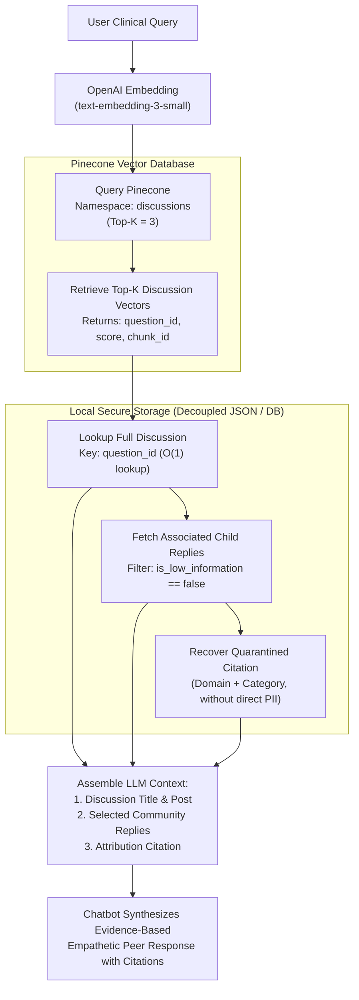

# Final Local Record and Pinecone Metadata Design Specification

**Project:** Medical-Agentic-Cancer-Chatbot  
**Document Type:** Technical Architecture & Ingestion Design Specification  
**Status:** Approved Design (Read-Only Specification)  
**Reference Document:** [pinecone_ingestion_dataset_audit.md](file:///c:/Users/charan/Desktop/Medical-Agentic-Cancer-Chatbot/reports/pinecone_ingestion_dataset_audit.md)  
**Target Systems:** Local JSON / Document Store (Full Text) & Pinecone Vector Database (Search Index)  
**Target Embedding Model:** OpenAI `text-embedding-3-small` (1,536 dimensions)  
**Pinecone Namespaces:** `discussions` and `replies`  

---

## Table of Contents

1. [Executive Summary & Design Principles](#1-executive-summary--design-principles)
2. [Beginner's Architecture Guide](#2-beginners-architecture-guide)
   - [2.1 The Two-Tier Storage Architecture](#21-the-two-tier-storage-architecture)
   - [2.2 Pinecone Namespaces Explained](#22-pinecone-namespaces-explained)
   - [2.3 Content Hashes (SHA-256) and Deterministic IDs](#23-content-hashes-sha-256-and-deterministic-ids)
   - [2.4 Why Vector Metadata Must Be Minimal and Clean](#24-why-vector-metadata-must-be-minimal-and-clean)
3. [Task 1: Local Normalized Record Schemas](#3-task-1-local-normalized-record-schemas)
   - [3.1 Normalized Discussion Record Schema](#31-normalized-discussion-record-schema)
   - [3.2 Normalized Reply Record Schema](#32-normalized-reply-record-schema)
   - [3.3 Synthetic Discussion Record Example](#33-synthetic-discussion-record-example)
   - [3.4 Synthetic Reply Record Example](#34-synthetic-reply-record-example)
4. [Task 2: Pinecone Vector & Metadata Schemas](#4-task-2-pinecone-vector--metadata-schemas)
   - [4.1 Metadata Privacy & Size Constraints](#41-metadata-privacy--size-constraints)
   - [4.2 Namespace: `discussions`](#42-namespace-discussions)
   - [4.3 Namespace: `replies`](#43-namespace-replies)
   - [4.4 Field Definition & Purpose Table](#44-field-definition--purpose-table)
5. [Task 3: Empirically Grounded Chunking Policy](#5-task-3-empirically-grounded-chunking-policy)
   - [5.1 Summary of Text Distribution Findings](#51-summary-of-text-distribution-findings)
   - [5.2 Short Discussions (11 – 200 words)](#52-short-discussions-11--200-words)
   - [5.3 Long Discussions (200 – 4,938 words)](#53-long-discussions-200--4938-words)
   - [5.4 Short Replies (1 – 2 words)](#54-short-replies-1--2-words)
   - [5.5 Long Replies (200 – 2,381 words)](#55-long-replies-200--2381-words)
   - [5.6 Chunk Overlap Strategy & Context Preservation](#56-chunk-overlap-strategy--context-preservation)
6. [Task 4: Special Dataset Conditions & Privacy Guardrails](#6-task-4-special-dataset-conditions--privacy-guardrails)
   - [4.1 Handling 230 Discussions with Exactly 50 Replies](#41-handling-230-discussions-with-exactly-50-replies)
   - [4.2 Handling 255 Replies with Two Words or Fewer](#42-handling-255-replies-with-two-words-or-fewer)
   - [4.3 Public Forum URLs and External Hyperlinks](#43-public-forum-urls-and-external-hyperlinks)
   - [4.4 Physician Names and First-Name Signatures](#44-physician-names-and-first-name-signatures)
7. [Task 5: End-to-End Retrieval Mapping Pipeline](#7-task-5-end-to-end-retrieval-mapping-pipeline)
   - [7.1 End-to-End Retrieval Workflow Diagram](#71-end-to-end-retrieval-workflow-diagram)
   - [7.2 Detailed Retrieval Sequence](#72-detailed-retrieval-sequence)
   - [7.3 Traceable Reference Generation](#73-traceable-reference-generation)
8. [Task 6: Validation, Quality Assurance & Idempotency Requirements](#8-task-6-validation-quality-assurance--idempotency-requirements)
   - [8.1 Test Matrix & Acceptance Gates](#81-test-matrix--acceptance-gates)
   - [8.2 Automated Assertion Suite](#82-automated-assertion-suite)
9. [Unresolved Privacy Blockers & Governance Review](#9-unresolved-privacy-blockers--governance-review)
10. [Recommendation for Next Implementation Milestone](#10-recommendation-for-next-implementation-milestone)

---

## 1. Executive Summary & Design Principles

This specification establishes the final schema definitions, chunking rules, vector metadata layouts, and retrieval pipelines for the `Medical-Agentic-Cancer-Chatbot` knowledge base.

Based on our exhaustive read-only audit of 300 discussions and 12,603 replies across `data/raw/` and `data/processed/`, the architecture is built on six foundational principles:

1. **Decoupled Architecture (Two-Tier Storage):** Full narrative text, clinical details, and quarantined provenance links reside solely in local, secure JSON storage. The Pinecone vector database acts purely as a semantic lookup index containing mathematical vectors and lightweight routing metadata.
2. **Zero-PII Vector Metadata:** Pinecone metadata must contain **zero raw patient text, zero public URLs, zero doctor names, and zero patient sign-offs**. This guarantees complete privacy containment regardless of vector cloud operations.
3. **Preservation Without Silent Modification:** The source raw and processed JSON files remain untouched. Any cleaning, deduplication, or normalization occurs in a new, separate normalized local storage layer where raw and sanitized variants are tracked side-by-side.
4. **Discussion-First Retrieval Topology:** Retrieval prioritizes finding the most semantically relevant parent discussion thread (`discussions` namespace) before retrieving or scoring child replies (`replies` namespace).
5. **No Arbitrary Data Discarding:** Low-information items (e.g., 255 replies with $\le 2$ words) and truncated threads (230 discussions with 50 replies) are preserved in local storage and explicitly flagged with boolean metadata rather than deleted.
6. **Strict Idempotency & Determinism:** All vector IDs, record keys, chunk indexes, and content hashes are deterministic. Running the ingestion pipeline multiple times produces the exact same vector IDs and representations without duplicate database entries.

---

## 2. Beginner's Architecture Guide

> [!NOTE]
> All examples in this section use synthetic analogies and non-patient data to explain core engineering concepts clearly.

### 2.1 The Two-Tier Storage Architecture

Why don't we just store all the patient forum posts and replies directly inside Pinecone?

- **Analogy:** Imagine a busy medical research library. The library has millions of pages of research papers stored safely in climate-controlled archives (Tier 1: Local Storage). In the front lobby, the library provides a computerized index card catalog (Tier 2: Pinecone Vector Database). 
- **How it works:**
  - The card catalog doesn't contain the full 50-page paper; it only holds the paper's call number (`record_id`), topic category (`category`), and keywords.
  - When a doctor searches for "joint stiffness remedies", the card catalog points to Call Number `cat01_q01`.
  - The researcher then walks to the archive shelf and pulls the full document.
- **Why this is critical:**
  1. **Cost & Speed:** Storing large paragraphs of text in vector databases increases cloud storage costs and slows down similarity math.
  2. **Security & Privacy:** If vector database metadata ever leaked, having zero patient names, zero URLs, and zero raw text inside Pinecone ensures patient confidentiality is preserved.
  3. **Pinecone Metadata Limits:** Pinecone limits metadata to 40 KB per vector. Storing long forum threads in metadata risks hitting this ceiling.

### 2.2 Pinecone Namespaces Explained

**What is a Namespace?** A namespace is a dedicated sub-partition within a single Pinecone index. Queries sent to one namespace never search across another namespace unless specifically instructed.

In this project, we create two distinct namespaces:
1. `discussions`: Contains vectors generated from discussion titles and original post bodies.
2. `replies`: Contains vectors generated from individual community replies.

**Why use separate namespaces?**
- When a user asks a broad question (e.g., *"How do people cope with fear of recurrence?"*), we search the `discussions` namespace to find similar overall conversations.
- When a user asks a very specific factual question (e.g., *"Did anyone take cold caps during Taxol and what temperature worked?"*), we can search the `replies` namespace directly to find a specific community member's reply, while using its `question_id` to instantly pull in the parent thread context.

### 2.3 Content Hashes (SHA-256) and Deterministic IDs

- **Deterministic ID:** Instead of generating random UUIDs (like `4f8a-92b1...`) every time a script runs, we construct IDs using fixed, predictable formulas:
  $$\text{Discussion Vector ID} = \text{question\_id} + \text{"#c"} + \text{chunk\_index} \quad (\text{e.g., } \texttt{cat01\_q01\#c00})$$
  $$\text{Reply Vector ID} = \text{answer\_id} + \text{"#c"} + \text{chunk\_index} \quad (\text{e.g., } \texttt{cat01\_q01\_a05\#c00})$$
  If we re-run our ingestion script tomorrow, the vector IDs will be identical, allowing Pinecone to update existing records rather than creating messy duplicates.
- **Content Hash (SHA-256):** A SHA-256 hash is a 64-character digital fingerprint of a text block. If even a single comma changes in a post, the hash changes completely:
  $$\text{Hash of "Sample text"} = \texttt{b8c9e...}$$
  Storing this hash allows our pipeline to instantly detect if source data has changed without re-embedding thousands of unchanged files.

### 2.4 Why Vector Metadata Must Be Minimal and Clean

Vector metadata should answer only three questions:
1. **Who is the parent?** (`question_id`)
2. **What category does this belong to for filtering?** (`category`)
3. **What chunk number is this?** (`chunk_index`)

It should **never** include:
- The actual patient text (that belongs in local storage).
- The author's username or doctor's name.
- The web link to the discussion.

---

## 3. Task 1: Local Normalized Record Schemas

To eliminate discrepancies between the source JSON naming (`question_id`, `original_post`, `answers`) and application logic, while preserving 100% of the original content and relationships, we establish two separate normalized schemas:
1. **Discussion Records** (stored in `data/normalized/discussions.json` or SQLite)
2. **Reply Records** (stored in `data/normalized/replies.json` or SQLite)

---

### 3.1 Normalized Discussion Record Schema

```json
{
  "$schema": "http://json-schema.org/draft-07/schema#",
  "title": "NormalizedDiscussionRecord",
  "type": "object",
  "required": [
    "record_id",
    "question_id",
    "category_slug",
    "category_display",
    "discussion_title",
    "source_file",
    "source_url",
    "source_url_hash",
    "original_post_raw",
    "original_post_sanitized",
    "content_hash",
    "character_count",
    "word_count",
    "chunks",
    "answers_count",
    "reply_ids",
    "is_truncated_at_scrape",
    "summary"
  ],
  "properties": {
    "record_id": { "type": "string", "description": "Format: rec_disc_{question_id}" },
    "question_id": { "type": "string", "description": "Original source key e.g. cat01_q01" },
    "category_slug": { "type": "string", "description": "Normalized snake_case slug e.g. concerned_about_my_risk" },
    "category_display": { "type": "string", "description": "Original display category string" },
    "discussion_title": { "type": "string", "description": "Discussion title string" },
    "source_file": { "type": "string", "description": "Relative path to processed source file" },
    "source_url": { "type": "string", "description": "Quarantined public URL for provenance only" },
    "source_url_hash": { "type": "string", "description": "SHA-256 hash of source_url" },
    "original_post_raw": { "type": "string", "description": "Unmodified text from original_post.text" },
    "original_post_sanitized": { "type": "string", "description": "Secondary scrubbed text (PII/signatures removed)" },
    "content_hash": { "type": "string", "description": "SHA-256 hash of original_post_raw" },
    "character_count": { "type": "integer" },
    "word_count": { "type": "integer" },
    "chunks": {
      "type": "array",
      "items": {
        "type": "object",
        "required": ["chunk_id", "chunk_index", "chunk_text", "char_count", "word_count", "chunk_hash"],
        "properties": {
          "chunk_id": { "type": "string", "description": "Format: {question_id}#c{index}" },
          "chunk_index": { "type": "integer" },
          "chunk_text": { "type": "string" },
          "char_count": { "type": "integer" },
          "word_count": { "type": "integer" },
          "chunk_hash": { "type": "string" }
        }
      }
    },
    "answers_count": { "type": "integer", "description": "Total replies in dataset for this thread" },
    "reply_ids": { "type": "array", "items": { "type": "string" } },
    "is_truncated_at_scrape": { "type": "boolean", "description": "True if answers_count == 50" },
    "summary": { "type": ["string", "null"], "description": "Synthetic summary generated via LLM, or null" }
  }
}
```

---

### 3.2 Normalized Reply Record Schema

```json
{
  "$schema": "http://json-schema.org/draft-07/schema#",
  "title": "NormalizedReplyRecord",
  "type": "object",
  "required": [
    "record_id",
    "answer_id",
    "question_id",
    "category_slug",
    "reply_index",
    "source_file",
    "reply_text_raw",
    "reply_text_sanitized",
    "content_hash",
    "character_count",
    "word_count",
    "chunks",
    "is_low_information",
    "is_indexed_in_pinecone"
  ],
  "properties": {
    "record_id": { "type": "string", "description": "Format: rec_reply_{answer_id}" },
    "answer_id": { "type": "string", "description": "Original source key e.g. cat01_q01_a01" },
    "question_id": { "type": "string", "description": "Parent discussion key e.g. cat01_q01" },
    "category_slug": { "type": "string", "description": "Normalized snake_case slug" },
    "reply_index": { "type": "integer", "description": "1-based order within thread (1 to 50)" },
    "source_file": { "type": "string" },
    "reply_text_raw": { "type": "string", "description": "Unmodified text from answers[].text" },
    "reply_text_sanitized": { "type": "string", "description": "Secondary scrubbed text" },
    "content_hash": { "type": "string", "description": "SHA-256 hash of reply_text_raw" },
    "character_count": { "type": "integer" },
    "word_count": { "type": "integer" },
    "chunks": {
      "type": "array",
      "items": {
        "type": "object",
        "required": ["chunk_id", "chunk_index", "chunk_text", "char_count", "word_count", "chunk_hash"],
        "properties": {
          "chunk_id": { "type": "string", "description": "Format: {answer_id}#c{index}" },
          "chunk_index": { "type": "integer" },
          "chunk_text": { "type": "string" },
          "char_count": { "type": "integer" },
          "word_count": { "type": "integer" },
          "chunk_hash": { "type": "string" }
        }
      }
    },
    "is_low_information": { "type": "boolean", "description": "True if word_count <= 2" },
    "is_indexed_in_pinecone": { "type": "boolean", "description": "False if is_low_information is True" }
  }
}
```

---

### 3.3 Synthetic Discussion Record Example

```json
{
  "record_id": "rec_disc_cat01_q01",
  "question_id": "cat01_q01",
  "category_slug": "concerned_about_my_risk",
  "category_display": "Concerned About My Risk",
  "discussion_title": "Understanding Genomic Testing Scores and Long Term Management",
  "source_file": "data/processed/01_concerned_about_my_risk.json",
  "source_url": "https://community.example.org/discussion/719253/sample-thread-slug",
  "source_url_hash": "e3b0c44298fc1c149afbf4c8996fb92427ae41e4649b934ca495991b7852b855",
  "original_post_raw": "I recently received a recurrence score of 28. My oncologist recommended exploring endocrine therapies. Would love to hear how others navigated this decision.",
  "original_post_sanitized": "I recently received a recurrence score of 28. [ONCOLOGIST] recommended exploring endocrine therapies. Would love to hear how others navigated this decision.",
  "content_hash": "5d41402abc4b2a76b9719d911017c592f1bb6e1a4d40212f8623b36368d37446",
  "character_count": 158,
  "word_count": 22,
  "chunks": [
    {
      "chunk_id": "cat01_q01#c00",
      "chunk_index": 0,
      "chunk_text": "Understanding Genomic Testing Scores and Long Term Management\n\nI recently received a recurrence score of 28. [ONCOLOGIST] recommended exploring endocrine therapies. Would love to hear how others navigated this decision.",
      "char_count": 221,
      "word_count": 31,
      "chunk_hash": "7a38b1f8b8981292b34a6639c054e7d69d4c2053f31cf31a89c934f0d6a2f7c0"
    }
  ],
  "answers_count": 50,
  "reply_ids": [
    "cat01_q01_a01",
    "cat01_q01_a02",
    "cat01_q01_a03"
  ],
  "is_truncated_at_scrape": true,
  "summary": null
}
```

---

### 3.4 Synthetic Reply Record Example

```json
{
  "record_id": "rec_reply_cat01_q01_a01",
  "answer_id": "cat01_q01_a01",
  "question_id": "cat01_q01",
  "category_slug": "concerned_about_my_risk",
  "reply_index": 1,
  "source_file": "data/processed/01_concerned_about_my_risk.json",
  "reply_text_raw": "I had a score of 26 five years ago. Getting a second opinion from a specialist center really helped clarify my adjuvant treatment plan. Warmly, Sarah.",
  "reply_text_sanitized": "I had a score of 26 five years ago. Getting a second opinion from a specialist center really helped clarify my adjuvant treatment plan. [SIGNATURE]",
  "content_hash": "a82c61099f6ec35b67484df728be202e85a53926615b1c9a632490b4d4cf56f2",
  "character_count": 151,
  "word_count": 25,
  "chunks": [
    {
      "chunk_id": "cat01_q01_a01#c00",
      "chunk_index": 0,
      "chunk_text": "I had a score of 26 five years ago. Getting a second opinion from a specialist center really helped clarify my adjuvant treatment plan. [SIGNATURE]",
      "char_count": 147,
      "word_count": 24,
      "chunk_hash": "2f40078216c5a2c2ff9a59b5f5431665a3d702d8d85f7e71e36780c888ba3fa6"
    }
  ],
  "is_low_information": false,
  "is_indexed_in_pinecone": true
}
```

---

## 4. Task 2: Pinecone Vector & Metadata Schemas

### 4.1 Metadata Privacy & Size Constraints

Pinecone vectors are subject to an explicit size ceiling of **40 KB (40,960 bytes)** per vector. More importantly, clinical data governance requires that vector metadata contains **zero confidential data**.

| Permitted in Pinecone Metadata | FORBIDDEN in Pinecone Metadata |
| :--- | :--- |
| $\checkmark$ Record IDs (`cat01_q01#c00`) | $\times$ Raw patient text / quotes |
| $\checkmark$ Parent foreign keys (`question_id`) | $\times$ Public forum URLs (`source_url`) |
| $\checkmark$ Normalized category slugs (`concerned_about_my_risk`) | $\times$ Doctor / physician names |
| $\checkmark$ Numeric counts (`reply_count`, `word_count`) | $\times$ Member signatures / usernames |
| $\checkmark$ Content hash prefixes (first 16 chars) | $\times$ Email addresses or phone numbers |

---

### 4.2 Namespace: `discussions`

- **Namespace Name:** `discussions`
- **Embedding Input Text:** `"{discussion_title}\n\n{original_post_sanitized_chunk}"`
- **Vector ID Format:** `{question_id}#c{chunk_index:02d}` (e.g., `cat01_q01#c00`)
- **Dimensions:** 1,536

#### Synthetic JSON Representation

```json
{
  "id": "cat01_q01#c00",
  "values": [0.0142, -0.0289, 0.0815, 0.0031, "... 1536 floats ..."],
  "metadata": {
    "doc_type": "discussion",
    "question_id": "cat01_q01",
    "category": "concerned_about_my_risk",
    "chunk_index": 0,
    "total_chunks": 1,
    "reply_count": 50,
    "word_count": 245,
    "char_count": 1420,
    "is_truncated": true,
    "has_replies": true,
    "content_hash_prefix": "5d41402abc4b2a76"
  }
}
```

---

### 4.3 Namespace: `replies`

- **Namespace Name:** `replies`
- **Embedding Input Text:** `"[In response to: {discussion_title}]\n\n{reply_text_sanitized_chunk}"`
- **Vector ID Format:** `{answer_id}#c{chunk_index:02d}` (e.g., `cat01_q01_a01#c00`)
- **Dimensions:** 1,536

#### Synthetic JSON Representation

```json
{
  "id": "cat01_q01_a01#c00",
  "values": [-0.0051, 0.0412, -0.0198, 0.0634, "... 1536 floats ..."],
  "metadata": {
    "doc_type": "reply",
    "answer_id": "cat01_q01_a01",
    "question_id": "cat01_q01",
    "category": "concerned_about_my_risk",
    "reply_index": 1,
    "chunk_index": 0,
    "total_chunks": 1,
    "word_count": 85,
    "char_count": 490,
    "is_low_information": false,
    "content_hash_prefix": "a82c61099f6ec35b"
  }
}
```

---

### 4.4 Field Definition & Purpose Table

| Metadata Key | Target Namespace | Data Type | Purpose & Search Utilization |
| :--- | :--- | :--- | :--- |
| `doc_type` | `discussions`, `replies` | `string` | Categorical discriminator (`"discussion"` vs `"reply"`). |
| `question_id` | `discussions`, `replies` | `string` | Core relational foreign key connecting child reply vectors directly to parent discussion records. |
| `answer_id` | `replies` | `string` | Unique identifier for specific reply vector lookup. |
| `category` | `discussions`, `replies` | `string` | Normalized snake_case category slug for Pinecone filter queries (e.g., `{"category": "in_treatment"}`). |
| `reply_index` | `replies` | `integer` | Sequence position of reply in thread (1 to 50). Allows filtering for early vs late responses. |
| `chunk_index` | `discussions`, `replies` | `integer` | Zero-based chunk counter for multi-chunk documents. |
| `total_chunks` | `discussions`, `replies` | `integer` | Total number of chunks originating from this parent text. |
| `reply_count` | `discussions` | `integer` | Community engagement count. Enables filtering for discussions with high reply volume. |
| `word_count` | `discussions`, `replies` | `integer` | Word count of the embedded text unit. |
| `char_count` | `discussions`, `replies` | `integer` | Character count of the embedded text unit. |
| `is_truncated` | `discussions` | `boolean` | Flags whether thread hit the 50-reply scraper ceiling. |
| `has_replies` | `discussions` | `boolean` | Quick boolean check (`reply_count > 0`). |
| `is_low_information`| `replies` | `boolean` | Set to `false` for indexed vectors; guards against noise. |
| `content_hash_prefix`| `discussions`, `replies`| `string` | First 16 characters of the SHA-256 content hash for data integrity assertions. |

*Estimated metadata payload size per vector: **~220 to 260 bytes** (less than 1% of Pinecone's 40 KB limit).*

---

## 5. Task 3: Empirically Grounded Chunking Policy

### 5.1 Summary of Text Distribution Findings

From our audit of all 12,903 text blocks:
- **Discussions (Original Posts):** Mean = 230.3 words (~300 tokens), Median = 127 words (~170 tokens), Min = 11 words, Max = 4,938 words (~6,500 tokens).
- **Replies:** Mean = 100.3 words (~133 tokens), Median = 67 words (~90 tokens), Min = 1 word, Max = 2,381 words (~3,100 tokens).

### 5.2 Short Discussions (11 – 200 words)
- **Distribution:** 78% of discussions have $\le 200$ words.
- **Policy:** **No chunking required.**
- **Format:** The entire title and post are embedded as a single chunk (`chunk_index = 0`):
  ```text
  {discussion_title}

  {original_post_sanitized}
  ```
- **Rationale:** Preserves complete narrative coherence without boundary fragmentation.

### 5.3 Long Discussions (200 – 4,938 words)
- **Distribution:** 22% of discussions exceed 200 words; maximum post is 4,938 words.
- **Policy:** **Sliding Window Chunking with Semantic Prepending.**
  - **Chunk Target Size:** 400 tokens (~300 words).
  - **Window Overlap:** 80 tokens (~60 words / 20% overlap).
  - **Splitting Strategy:** Recursive character splitting on natural boundaries (`\n\n`, `\n`, `. `, `, `).
  - **Context Prepending:** Every chunk automatically prepends the discussion title:
    ```text
    [Discussion: {discussion_title}] (Part {chunk_index + 1} of {total_chunks})

    {chunk_text}
    ```
- **Rationale:** Embedding a 4,938-word post into a single 1536-dimensional vector compresses too much disparate information, causing specific questions or symptom descriptions to be lost.

### 5.4 Short Replies (1 – 2 words)
- **Distribution:** **255 replies** contain 2 words or fewer (e.g., short acknowledgments, expressions of sympathy).
- **Policy:** **Preserve locally, exclude from vector indexing.**
  - Stored in full in `data/normalized/replies.json`.
  - Flagged with `is_low_information: true` and `is_indexed_in_pinecone: false`.
  - **Excluded from Pinecone `replies` namespace.**
- **Rationale:** 1-word vectors produce noisy, spurious vector matches (e.g., matching a user's clinical query to a 1-word comment). However, keeping them in local storage ensures full conversational completeness when hydrating a thread.

### 5.5 Long Replies (200 – 2,381 words)
- **Distribution:** ~8% of replies exceed 200 words; maximum reply is 2,381 words.
- **Policy:** **Sliding Window Chunking with Context Prepending.**
  - **Chunk Target Size:** 350 tokens (~260 words).
  - **Window Overlap:** 70 tokens (~50 words / 20% overlap).
  - **Context Prepending:**
    ```text
    [Reply to: {discussion_title}] (Part {chunk_index + 1} of {total_chunks})

    {chunk_text}
    ```

### 5.6 Chunk Overlap Strategy & Context Preservation

```text
[Original Long Post]
|-------------------- Chunk 0 (0 - 400 tokens) -------------------->|
                                    |<-- 80 token overlap -->|
                                    |------------------- Chunk 1 (320 - 720 tokens) ------------------->|
```

The 80-token overlap prevents clinical information splits where a symptom and its associated treatment or medication dosage fall on opposite sides of an arbitrary character boundary.

---

## 6. Task 4: Special Dataset Conditions & Privacy Guardrails

### 4.1 Handling 230 Discussions with Exactly 50 Replies
- **Condition:** 76.7% of all discussion threads have exactly 50 replies due to web scraping truncation.
- **Solution:**
  - In normalized local records: `is_truncated_at_scrape = true`.
  - In Pinecone metadata: `is_truncated = true`.
  - **Application Guardrail:** When the chatbot cites a truncated thread, the response generation prompt instructs the LLM: *"Note: This community thread contains additional replies on the forum beyond the 50 archived here."*
  - **Integrity Rule:** No records are discarded or merged to simulate completeness.

### 4.2 Handling 255 Replies with Two Words or Fewer
- **Condition:** 255 replies contain 1 or 2 words.
- **Solution:**
  - Preserved verbatim in local storage (`reply_text_raw`).
  - Marked with `is_low_information: true`.
  - Omitted from Pinecone embedding generation.
  - When a parent discussion is retrieved, the chatbot's hydration engine can display the total reply count while optionally suppressing low-information replies from the prompt context to conserve LLM tokens.

### 4.3 Public Forum URLs and External Hyperlinks
- **Condition:** 300 unredacted `source_url` fields and 695 external hyperlinks in post bodies.
- **Solution (Four-Layer Isolation):**
  1. **Source JSONs (`data/raw`, `data/processed`):** Left 100% untouched.
  2. **Local Normalized Storage:** `source_url` is quarantined under restricted access. A SHA-256 hash (`source_url_hash`) is generated for lookups.
  3. **Sanitized Text Generation:** In `original_post_sanitized` and `reply_text_sanitized`, all external URLs are replaced with `[EXTERNAL_LINK]`.
  4. **Pinecone Metadata:** `source_url` is **strictly excluded**.

### 4.4 Physician Names and First-Name Signatures
- **Condition:** 115 physician mentions ("Dr. [LastName]") and 83 first-name signatures.
- **Solution:**
  - During local normalization, a regex/NER secondary scrubbing pass creates `original_post_sanitized` and `reply_text_sanitized`:
    - `r"\b(?:Dr\.|Doctor)\s+[A-Z][a-z]+(?:\s+[A-Z][a-z]+)?\b"` $\rightarrow$ `"[PHYSICIAN]"`
    - `r"\b(?:Hugs|Love|Warmly|Best|Cheers|Blessings|Sincerely),\s*\n*[A-Z][a-z]+\b"` $\rightarrow$ `"[SIGNATURE]"`
  - The raw text in local storage remains untouched for audit fidelity. Only the sanitized variant is passed to OpenAI for vector embedding.

---

## 7. Task 5: End-to-End Retrieval Mapping Pipeline

### 7.1 End-to-End Retrieval Workflow Diagram



---

### 7.2 Detailed Retrieval Sequence

#### Step 1: User Query Embedding
The user submits a prompt (e.g., *"How do people manage joint stiffness on anastrozole?"*). The application calls OpenAI's `text-embedding-3-small` to produce a 1,536-dimensional query vector $Q$.

#### Step 2: Discussion-First Pinecone Query
The query vector $Q$ is sent to Pinecone targeting the `discussions` namespace:
```python
# Discussion-First Query
results = index.query(
    namespace="discussions",
    vector=query_vector,
    top_k=3,
    include_metadata=True,
    filter={"category": "in_treatment"}  # Optional category routing
)
```

#### Step 3: Vector Match Resolution
Pinecone returns matched items:
```json
[
  {
    "id": "cat03_q12#c00",
    "score": 0.892,
    "metadata": {
      "question_id": "cat03_q12",
      "category": "in_treatment",
      "reply_count": 48
    }
  }
]
```

#### Step 4: Local Full-Text Hydration
The application extracts `question_id = "cat03_q12"`. Using an in-memory hash map or local SQLite index, it performs an $O(1)$ lookup:
1. Loads `rec_disc_cat03_q12` from `data/normalized/discussions.json`.
2. Loads all child replies where `question_id == "cat03_q12"` from `data/normalized/replies.json`.
3. Filters out any replies marked `is_low_information: true`.

#### Step 5: Optional Fine-Grained Reply Re-Ranking
If the discussion contains many replies (e.g., 48 replies), the application can either:
- **Approach A (Fast Local):** Select the first $N$ replies plus any reply containing matching keyword entities.
- **Approach B (Hybrid Pinecone Vector Re-Rank):** Query the `replies` namespace filtering specifically by `{"question_id": "cat03_q12"}` to fetch the top 5 most relevant individual replies within that specific thread.

#### Step 6: Context Assembly for the LLM
The assembled prompt context combines the parent problem statement and the community responses:
```text
[CONTEXT FROM PEER DISCUSSION ARCHIVE]
Topic: Joint Stiffness Strategies on Anastrozole (Thread ID: cat03_q12)
Initial Discussion:
"Patient asking about morning joint stiffness after starting anastrozole..."

Selected Community Member Experiences:
- Member Reply 1: "Taking a warm bath in the morning and taking the pill at night helped me..."
- Member Reply 2: "My care team recommended 30 minutes of gentle yoga..."
```

---

### 7.3 Traceable Reference Generation

To provide transparent citations without leaking patient forum profiles:
- **Internal Traceability:** The response payload logs `question_id` (`cat03_q12`) and `content_hash` for auditing.
- **User-Facing Citation:** The citation displays category provenance and sanitized thread titles rather than raw URLs:
  > *Source: Breast Cancer Community Archive — Category: In Treatment — Topic: "Joint Stiffness Strategies on Anastrozole" (Archived Discussion `cat03_q12`)*

---

## 8. Task 6: Validation, Quality Assurance & Idempotency Requirements

Before initiating vector database ingestion, the normalized records and ingestion scripts must satisfy six automated validation gates.

### 8.1 Test Matrix & Acceptance Gates

| Gate # | Test Name | Validation Logic | Target Metric |
| :---: | :--- | :--- | :---: |
| **G-1** | **Record ID Uniqueness** | Verify all `record_id` and `chunk_id` values are unique across all records. | 100% Unique (0 duplicates) |
| **G-2** | **Parent-Child Integrity** | Assert that every `reply.question_id` exists in `discussions.question_id`. | 100% Match (0 orphaned replies) |
| **G-3** | **Category Normalization** | Verify `category_slug` conforms strictly to regex `^[a-z0-9_]+$` across all items. | 100% Valid slugs |
| **G-4** | **Chunk Reconstruction** | Reconstruct text from chunks and verify length equals sanitized source text. | 100% Text Match |
| **G-5** | **Content Hash Verification** | Compute `sha256(text_raw)` and assert equality with `content_hash`. | 100% Hash Consistency |
| **G-6** | **Zero-PII Assertion** | Scan Pinecone metadata dictionaries for URLs, `@`, `Dr.`, and phone formats. | Exactly 0 PII matches |
| **G-7** | **Ingestion Idempotency** | Ingest records twice into a test namespace; assert total vector count is unchanged. | 0 Duplicate Vectors |

---

### 8.2 Automated Assertion Suite

```python
# Reference test assertions to implement in tests/test_normalized_records.py

def test_parent_child_integrity(discussions, replies):
    valid_qids = {d["question_id"] for d in discussions}
    for r in replies:
        assert r["question_id"] in valid_qids, f"Orphaned reply: {r['answer_id']}"

def test_deterministic_id_reproducibility(discussions):
    for d in discussions:
        expected_id = f"rec_disc_{d['question_id']}"
        assert d["record_id"] == expected_id, f"Non-deterministic ID: {d['record_id']}"

def test_zero_pii_in_pinecone_metadata(pinecone_payloads):
    for vec in pinecone_payloads:
        meta = vec["metadata"]
        meta_str = str(meta).lower()
        assert "http://" not in meta_str and "https://" not in meta_str, "URL found in metadata"
        assert "@" not in meta_str, "Email/handle found in metadata"
        assert "dr. " not in meta_str, "Doctor title found in metadata"
        assert "text" not in meta, "Raw text field found in metadata"
```

---

## 9. Unresolved Privacy Blockers & Governance Review

While this design establishes complete technical containment, the following governance prerequisites must be formally signed off by project stakeholders before running the embedding pipeline:

1. **Third-Party API Data Transmission Agreement:** Formal confirmation that sending sanitized patient forum text (with all PII scrubbed) to OpenAI's commercial embedding endpoint (`text-embedding-3-small`) complies with institutional and project privacy standards.
2. **Quarantine Policy for Source URLs:** Stakeholder agreement that original forum URLs will be permanently quarantined in local storage and never exposed to the LLM context or public end-users.
3. **Automated Secondary Sanitization Approval:** Approval of the regex/NER replacement rules for physician names (`[PHYSICIAN]`) and member sign-offs (`[SIGNATURE]`).

---

## 10. Recommendation for Next Implementation Milestone

With the architecture, schemas, chunking rules, and metadata structures now finalized and validated against the dataset's actual characteristics, the project is ready for implementation upon privacy sign-off.

### Recommended Next Milestone: **Milestone 1 — Normalization & Secondary Sanitization Pipeline**

We recommend proceeding to build the local transformation pipeline as the immediate next step:

1. **Step 1: Create `scripts/normalize_dataset.py`**
   - Reads `data/processed/*.json` without modifying them.
   - Applies the secondary sanitization pass (masking physician names, signatures, external URLs).
   - Generates deterministic IDs, chunk arrays, and SHA-256 content hashes.
   - Outputs normalized local records to `data/normalized/discussions.json` and `data/normalized/replies.json`.
2. **Step 2: Create `tests/test_normalized_records.py`**
   - Implements the automated validation suite (Gates G-1 through G-6).
3. **Step 3: Review Normalized Output with Privacy Officer**
   - Inspect the resulting `data/normalized/` files to verify that all PII has been thoroughly eliminated prior to any external API processing.
4. **Step 4: Pinecone Ingestion Script (`scripts/ingest_to_pinecone.py`)**
   - Connects to Pinecone and executes the multi-namespace upsert using the validated metadata schema.
