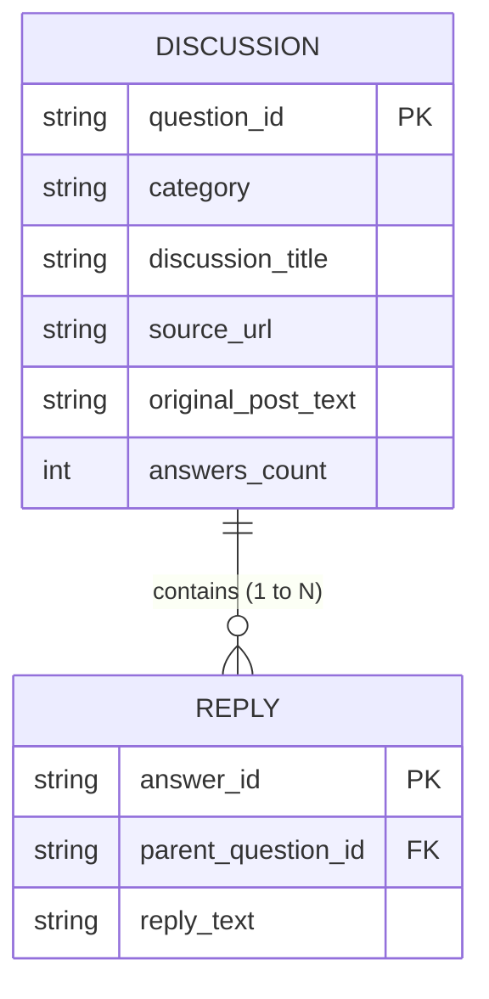

# Knowledge Base Audit Report: Pinecone Ingestion Readiness

**Project:** Medical-Agentic-Cancer-Chatbot  
**Audit Type:** Read-Only Knowledge Base Inspection & Pinecone Ingestion Readiness  
**Target Storage:** Local JSON Storage (Full Content) + Pinecone Vector Database (Search Index)  
**Proposed Embedding Provider & Model:** OpenAI `text-embedding-3-small` (1,536 dimensions)  
**Audit Scope:** 6 Raw Files (`data/raw/*.json`) and 6 Processed Files (`data/processed/*.json`)  
**Audit Date:** November 2026  
**Status:** Completed (Read-Only)

---

## Table of Contents

1. [Executive Summary](#1-executive-summary)
2. [Beginner's Primer: Core Concepts in Vector Retrieval](#2-beginners-primer-core-concepts-in-vector-retrieval)
   - [2.1 What is a Record?](#21-what-is-a-record)
   - [2.2 What is a Chunk?](#22-what-is-a-chunk)
   - [2.3 What is an Embedding?](#23-what-is-an-embedding)
   - [2.4 What is Metadata?](#24-what-is-metadata)
   - [2.5 Why Do We Need Parent-Child Relationships?](#25-why-do-we-need-parent-child-relationships)
3. [Dataset Overview & Quantitative Summary](#3-dataset-overview--quantitative-summary)
4. [Actual JSON Schema & Field Mapping](#4-actual-json-schema--field-mapping)
   - [4.1 Discrepancies Between Project Terminology and Actual JSON Keys](#41-discrepancies-between-project-terminology-and-actual-json-keys)
   - [4.2 JSON Structure Breakdown](#42-json-structure-breakdown)
   - [4.3 Field Mapping Table](#43-field-mapping-table)
5. [Comprehensive 12-Point Knowledge Base Audit](#5-comprehensive-12-point-knowledge-base-audit)
   - [5.1 Discussion IDs and Uniqueness](#51-discussion-ids-and-uniqueness)
   - [5.2 Category Fields and Values](#52-category-fields-and-values)
   - [5.3 Discussion Titles](#53-discussion-titles)
   - [5.4 Source URL Fields](#54-source-url-fields)
   - [5.5 Original Post Text Fields](#55-original-post-text-fields)
   - [5.6 Answers / Replies Structure](#56-answers--replies-structure)
   - [5.7 Reply IDs and Uniqueness](#57-reply-ids-and-uniqueness)
   - [5.8 Reply-to-Discussion Relationships](#58-reply-to-discussion-relationships)
   - [5.9 Summary Fields (Presence / Absence)](#59-summary-fields-presence--absence)
   - [5.10 Null, Missing, Duplicate, or Malformed Records](#510-null-missing-duplicate-or-malformed-records)
   - [5.11 Discussion and Reply Counts per Category](#511-discussion-and-reply-counts-per-category)
   - [5.12 Privacy-Cleaning Characteristics and Critical Limitations](#512-privacy-cleaning-characteristics-and-critical-limitations)
6. [Discussion-Reply Relationship Deep Dive](#6-discussion-reply-relationship-deep-dive)
7. [Privacy Findings & Clinical Governance Review](#7-privacy-findings--clinical-governance-review)
8. [Missing Information & Ingestion Blockers](#8-missing-information--ingestion-blockers)
9. [Proposed Local Record Structure (Full Storage)](#9-proposed-local-record-structure-full-storage)
10. [Proposed Pinecone Metadata Structure (Vector Index)](#10-proposed-pinecone-metadata-structure-vector-index)
11. [Questions Requiring Stakeholder Clarification](#11-questions-requiring-stakeholder-clarification)
12. [GO / NO-GO Recommendation](#12-go--no-go-recommendation)

---

## 1. Executive Summary

A comprehensive, read-only audit was conducted across all six forum category datasets within the `Medical-Agentic-Cancer-Chatbot` project workspace, examining both `data/raw/` and `data/processed/`.

The primary objectives of this audit were:
1. Verify structural consistency and relational integrity across discussions and replies.
2. Confirm ID uniqueness and check for null, duplicate, or malformed fields.
3. Inspect privacy sanitization applied between raw and processed versions.
4. Formulate the technical schema for local JSON storage and Pinecone vector search.
5. Provide a formal **GO / NO-GO** recommendation prior to invoking any embedding APIs or uploading data to Pinecone.

### Summary of Audit Findings

- **Record Completeness & Structural Quality:** High. Across all 300 discussions and 12,603 replies, there are **0 missing keys, 0 null values, 0 empty text fields, and 0 duplicate IDs**.
- **Schema Naming Disparity:** The actual JSON keys diverge from standard discussion terminology: the primary identifier is named `question_id` (not `discussion_id`), the original post is a dictionary `{"text": "..."}` rather than a raw string, and replies are contained in a list named `answers` where individual items have `answer_id` and `text`.
- **Relationship Architecture:** Parent-child relationships are strictly 1-to-many (1 discussion : N replies). While child replies do not have an explicit foreign key attribute, their IDs deterministically incorporate the parent ID (`cat01_q01_a01` -> parent `cat01_q01`).
- **Data Truncation / Scrape Artifacts:** Exactly 230 out of 300 discussions (76.7%) have exactly 50 replies, revealing an artificial ceiling introduced during web scraping.
- **Privacy Sanitization Scope:** Cleaning was applied to only 102 text elements out of 12,903 total blocks (0.79%). Sanitization replaced phone numbers (`[phone redacted]`: 35), email addresses (`[email redacted]`: 3), and select usernames (`[user redacted]`: 118).
- **Critical Privacy Vulnerability:** Every discussion retains an unredacted `source_url` pointing directly to the live, public forum thread on `community.breastcancer.org`. This allows immediate re-identification of original authors, unredacted names, profile pictures, and timestamps. Furthermore, 115 physician name mentions ("Dr. [Name]"), 83 first-name signatures, and 695 external URLs remain inside the post text.

---

## 2. Beginner's Primer: Core Concepts in Vector Retrieval

To ensure all team members and stakeholders share a common vocabulary, this section explains the five foundational concepts of vector search and Retrieval-Augmented Generation (RAG).

> [!NOTE]
> All examples in this section are synthetic and do not reproduce real patient content.

---

### 2.1 What is a Record?

**Definition:** A **record** is a complete, self-contained unit of source data stored in a primary database or file system. It contains the raw, unmodified text alongside its identifying attributes.

**Analogy:** Think of a record as a complete book in a public library, or an entire medical chart in a file cabinet. It holds all the chapters, pages, appendices, and author details in one place.

**Synthetic Example:**
```json
{
  "record_id": "REC-9021",
  "title": "Managing Everyday Fatigue During Wellness Recovery",
  "category": "lifestyle_support",
  "author_id": "member_404",
  "full_text": "Over the past six months, I found that taking short 15-minute walks in the morning significantly helped with afternoon energy dips. Staying hydrated with herbal tea was also very beneficial...",
  "created_at": "2024-03-15T10:30:00Z"
}
```

**Role in This Project:** In our architecture, the **local JSON files** store the full records. We do not store large blocks of text in the vector database because vector databases are optimized for numerical search, not bulk content storage.

---

### 2.2 What is a Chunk?

**Definition:** A **chunk** is a smaller, focused segment of text extracted from a larger record. Long documents are broken down into chunks so language models and embedding models can digest them without losing detail or exceeding memory limits.

**Analogy:** If a record is an entire textbook, a chunk is a single paragraph or section focused on one specific topic (e.g., "Hydration Tips"). If you ask a librarian a question, you want the exact relevant paragraph, not the whole 500-page book dumped on your desk.

**Synthetic Example:**
From the 1,000-word record above, we extract Chunk #1:
```text
Chunk 1: "Over the past six months, I found that taking short 15-minute walks in the morning significantly helped with afternoon energy dips."
```

**Role in This Project:** Forum posts can range from 20 words to nearly 5,000 words. A 5,000-word post cannot be effectively embedded as a single vector without diluting specific answers. Splitting long posts into chunks ensures each specific symptom, advice, or question receives its own distinct search representation.

---

### 2.3 What is an Embedding?

**Definition:** An **embedding** is a list of floating-point numbers (a high-dimensional mathematical vector) generated by an AI model (like OpenAI's `text-embedding-3-small`) that represents the *semantic meaning* of a chunk of text.

**Analogy:** Imagine placing words or concepts on a multi-dimensional map. Concepts that mean similar things (like "fatigue", "exhaustion", "tiredness", and "feeling drained") end up right next to each other on the map, even though they are spelled with completely different letters. The embedding is simply the GPS coordinates of that text on the map.

**Synthetic Example:**
Text: `"Tips for afternoon tiredness"`  
Vector (1536 numbers):
```text
[-0.0142, 0.0891, -0.0315, 0.0042, ..., 0.0712]
```
When a patient types: `"How do I handle low energy after lunch?"`, the system converts that question into coordinates and finds the chunks sitting closest to those coordinates on the map.

**Role in This Project:** OpenAI converts our discussion titles, posts, and replies into 1,536-dimensional vectors. These vectors are uploaded to Pinecone so our chatbot can instantly match user questions to relevant peer experiences.

---

### 2.4 What is Metadata?

**Definition:** **Metadata** is structured "data about the data" attached directly to each vector in Pinecone. It does not alter the vector coordinates; instead, it provides labels and filters.

**Analogy:** When you buy a jar of spice at the supermarket, the barcode lets the scanner look up the price, but the paper label tells you the expiration date, organic certification, and aisle number. That label is metadata.

**Synthetic Example:**
```json
{
  "vector_id": "vec_cat01_q01_c01",
  "values": [-0.0142, 0.0891, -0.0315, ...],
  "metadata": {
    "discussion_id": "cat01_q01",
    "category": "lifestyle_support",
    "chunk_type": "discussion_title_and_post",
    "chunk_index": 0,
    "total_replies": 12,
    "character_count": 480
  }
}
```

**Role in This Project:** Metadata allows Pinecone to perform fast **hybrid filtering**. For example, if a user is asking specifically about treatment options, the chatbot can tell Pinecone: *"Only search vectors where `category == 'in_treatment'`."*

---

### 2.5 Why Do We Need Parent-Child Relationships?

**Definition:** A **parent-child relationship** links a high-level container (the Parent: the original discussion question) to its sub-components (the Children: individual replies or chunks).

**Analogy:** Imagine a tree. The trunk is the main topic (Parent), and the branches and leaves are the comments and advice (Children). If someone hands you a single leaf that says *"I took 200mg and it worked"*, that advice is useless and potentially dangerous unless you know which tree it fell from (e.g., What medication? What stage? What condition?).

**Synthetic Example:**
- **Parent Record (`disc_550`):** "What strategies helped you cope with joint stiffness after waking up?"
- **Child Reply #1 (`disc_550_rep_01`):** "A warm shower first thing in the morning made all the difference for me."
- **Child Reply #2 (`disc_550_rep_02`):** "My physical therapist recommended gentle ankle rotations before stepping out of bed."

**Role in This Project:** The project specification establishes a **"Discussion-first, with relevant replies"** retrieval strategy:
1. The user asks a question.
2. The search engine matches against the **Parent discussion** to identify the most relevant overarching conversation.
3. Once the parent discussion is found, the system retrieves the parent's **Child replies** from local storage to give the chatbot the full conversational context.
4. Without parent-child tracking, replies become detached fragments lacking clinical context.

---

## 3. Dataset Overview & Quantitative Summary

The knowledge base consists of six categories scraped from `community.breastcancer.org`. Both the `data/raw/` and `data/processed/` directories contain the identical set of six JSON files.

### Dataset High-Level Metrics

| Metric | Total Count / Value | Notes |
| :--- | :--- | :--- |
| **Total Categories / Files** | 6 | Exactly 1 JSON file per category |
| **Total Discussions** | 300 | Exactly 50 discussions per file |
| **Total Replies (Answers)** | 12,603 | Range: 1,533 to 2,415 replies per file |
| **Total Text Elements** | 12,903 | 300 original posts + 12,603 replies |
| **Total Estimated Tokens** | ~1,799,176 tokens | ~98,418 tokens (OPs) + ~1,700,758 tokens (Replies) |
| **Total Raw File Size** | 8,300,531 bytes | ~8.30 MB |
| **Total Processed File Size** | 8,354,282 bytes | ~8.35 MB (+53.7 KB due to redaction tags) |
| **Missing / Null Records** | 0 | 100% field population |
| **Duplicate IDs** | 0 | 100% globally unique |

---

## 4. Actual JSON Schema & Field Mapping

### 4.1 Discrepancies Between Project Terminology and Actual JSON Keys

A critical finding of this audit is that the schema in the codebase uses different property names from the project documentation:

1. **`question_id` vs `discussion_id`:** The discussion identifier is keyed as `question_id`.
2. **`original_post` is an Object:** `original_post` is not a primitive string. It is a nested dictionary: `{"text": "..."}`.
3. **`answers` vs `replies`:** Replies are stored under the array key `answers`.
4. **`answers_count` vs `reply_count`:** The reply count integer is stored under `answers_count`.
5. **`answer_id` vs `reply_id`:** Each reply item is keyed as `answer_id`.
6. **No Summary Fields:** Neither `summary` nor `discussion_summary` exists in any raw or processed file.

### 4.2 JSON Structure Breakdown

Every item in both raw and processed JSON files strictly adheres to this structure:

```json
[
  {
    "question_id": "cat01_q01",
    "category": "Concerned About My Risk",
    "source_url": "https://community.breastcancer.org/en/discussion/719253/long-term-high-oncotype-test-survivors",
    "discussion_title": "Long Term High Oncotype Test Survivors",
    "original_post": {
      "text": "Discussion body text here..."
    },
    "answers_count": 50,
    "answers": [
      {
        "answer_id": "cat01_q01_a01",
        "text": "First reply text here..."
      },
      {
        "answer_id": "cat01_q01_a02",
        "text": "Second reply text here..."
      }
    ]
  }
]
```

### 4.3 Field Mapping Table

| JSON Key | Inferred / Actual Data Type | Cardinality | Nullable? | Description & Architectural Purpose |
| :--- | :--- | :--- | :--- | :--- |
| `question_id` | `string` (`catXX_qYY`) | 1 per discussion | No (0 nulls) | Primary identifier for the discussion thread. Deterministic format. |
| `category` | `string` | 1 per discussion | No (0 nulls) | Clinical / support forum category name. Used for metadata filtering. |
| `source_url` | `string` (valid URI) | 1 per discussion | No (0 nulls) | Canonical URL to the original thread on `community.breastcancer.org`. |
| `discussion_title`| `string` | 1 per discussion | No (0 nulls) | Thread title created by the initial poster. High semantic retrieval value. |
| `original_post` | `object` (`{"text": string}`) | 1 per discussion | No (0 nulls) | Container object holding the original post text under the `"text"` key. |
| `answers_count` | `integer` (non-negative) | 1 per discussion | No (0 nulls) | Count of replies included in the array. Exactly matches `len(answers)`. |
| `answers` | `array[object]` | 1 per discussion | No (0 nulls) | Ordered list of reply objects associated with the parent discussion. |
| `answers[].answer_id` | `string` (`catXX_qYY_aZZ`) | 1 per reply | No (0 nulls) | Primary identifier for the reply. Deterministically encodes the parent ID. |
| `answers[].text` | `string` | 1 per reply | No (0 nulls) | Text body of the community response or follow-up comment. |

---

## 5. Comprehensive 12-Point Knowledge Base Audit

### 5.1 Discussion IDs and Uniqueness
- **Key:** `question_id`
- **Format:** `cat{XX}_q{YY}` where `XX` is the zero-padded category index (`01` to `06`) and `YY` is the discussion index (`01` to `50`).
- **Audit Result:**
  - Total Discussions: 300
  - Unique Discussion IDs: 300 (100% uniqueness)
  - Duplicate IDs within files: 0
  - Duplicate IDs across files: 0
  - Null or empty IDs: 0

### 5.2 Category Fields and Values
- **Key:** `category`
- **Audit Result:**
  - Exactly one category string per file across all 50 items.
  - Category strings identified:
    1. `01_concerned_about_my_risk.json`: `"Concerned About My Risk"` (50 items)
    2. `02_connect_with_others.json`: `"Connect With Others Like Me"` (50 items)
    3. `03_in_treatment.json`: `"In Treatment"` (50 items)
    4. `04_metastatic_disease.json`: `"Living With Metastatic Disease"` (50 items)
    5. `05_managing_life.json`: `"Managing Life with cancer"` (50 items) *(Note: lowercase "with cancer")*
    6. `06_finished_treatment.json`: `"Finished treatment"` (50 items) *(Note: lowercase "treatment")*
- **Ingestion Concern:** Inconsistent casing ("Managing Life with cancer" vs "Finished treatment") requires slugification or string normalization prior to Pinecone metadata filtering.

### 5.3 Discussion Titles
- **Key:** `discussion_title`
- **Audit Result:**
  - Total Titles: 300
  - Unique Titles: 300 (100% uniqueness across entire dataset)
  - Character length: Mean = 36.5 chars, Min = 5 chars, Max = 99 chars
  - Word count: Mean = 5.9 words, Min = 1 word, Max = 15 words
  - Empty or whitespace-only titles: 0
- **Ingestion Value:** Discussion titles provide clean, concise semantic summaries of the user's intent and should be embedded as a primary retrieval target.

### 5.4 Source URL Fields
- **Key:** `source_url`
- **Format:** `https://community.breastcancer.org/en/discussion/{numeric_id}/{url_slug}`
- **Audit Result:**
  - Total URLs: 300
  - Unique URLs: 300 (100% uniqueness)
  - Empty or null URLs: 0
- **Governance Risk:** These URLs link to public web pages containing unredacted user profiles, member usernames, and original post timestamps.

### 5.5 Original Post Text Fields
- **Key:** `original_post.text`
- **Audit Result:**
  - Structure: Nested inside dictionary `{"text": "..."}`.
  - Total non-empty posts: 300 (100% populated).
  - Character count: Mean = 1,312.2 chars, Median = 680.5 chars, Min = 59 chars, Max = 28,512 chars.
  - Word count: Mean = 230.3 words, Median = 127.0 words, Min = 11 words, Max = 4,938 words.
- **Chunking Implication:** The median post (127 words / ~170 tokens) fits within a single embedding chunk. However, the maximum post (4,938 words / ~6,500 tokens) approach OpenAI's 8,191-token limit and must be segmented to prevent semantic dilution.

### 5.6 Answers / Replies Structure
- **Key:** `answers`
- **Audit Result:**
  - Encapsulated as a flat JSON array of objects inside each discussion item.
  - Every answer object contains exactly two keys: `answer_id` and `text`.
  - No auxiliary metadata is present (no timestamps, author handles, or vote counts).
  - Declared count key `answers_count` matches `len(answers)` in 100% of discussions (0 mismatches).

### 5.7 Reply IDs and Uniqueness
- **Key:** `answers[].answer_id`
- **Format:** `cat{XX}_q{YY}_a{ZZ}` where `ZZ` is the reply sequence index (`01` to `50`).
- **Audit Result:**
  - Total Replies: 12,603
  - Unique Reply IDs: 12,603 (100% global uniqueness)
  - Duplicate Reply IDs within discussions: 0
  - Duplicate Reply IDs across dataset: 0
  - Null or missing IDs: 0

### 5.8 Reply-to-Discussion Relationships
- **Audit Result:**
  - Nesting: Direct hierarchy (answers array nested in discussion object).
  - Foreign Key: There is no explicit `"parent_id"` or `"question_id"` property inside the answer object.
  - Implicit Key: The `answer_id` string hierarchically encodes the parent discussion ID:
    $$\text{Parent ID} = \text{substring of } \text{answer\_id up to second underscore}$$
    Example: `cat03_q12_a05` $\rightarrow$ Parent `cat03_q12`.
  - Topology: Strictly 1-to-many flat hierarchy. No nested tree or reply-to-reply threading exists.

### 5.9 Summary Fields (Presence / Absence)
- **Audit Result:**
  - Key Search: Thorough programmatic inspection of all keys across all raw and processed files revealed **zero summary fields**.
  - Impact: There are no pre-computed thread summaries. If discussion-level summaries are desired for fast indexing or LLM context compression, they must be synthesized via an LLM pipeline.

### 5.10 Null, Missing, Duplicate, or Malformed Records
- **Audit Result:**
  - JSON Syntax Errors: 0
  - Missing Mandatory Keys: 0
  - Null Fields: 0
  - Empty String Fields: 0
  - Duplicate Discussions or Replies: 0
- **Identified Data Anomalies:**
  1. **Very Short Replies:** 255 replies consist of 2 words or fewer (e.g., brief expressions, emotional acknowledgments, or conversational acknowledgments). If indexed blindly, these create low-information vector noise.
  2. **Conversational Tagging:** 11 instances of emotional expressions enclosed in brackets (e.g., `<eye roll>`, `<hugs>`, `<knocking wood furiously>`). These are not malformed HTML tags.
  3. **Whitespace Inconsistencies:** 2,462 replies contain internal carriage returns (`\r`), hard tabs (`\t`), or irregular multi-space sequences. Text normalization is needed before embedding.
  4. **Scrape Reply Cap:** 230 out of 300 discussions (76.7%) truncate at exactly 50 replies.

### 5.11 Discussion and Reply Counts per Category

| File Name | Formal Category Name | Discussions | Total Replies | Mean Replies / Disc | Min-Max Replies | Mean OP Words | Mean Reply Words |
| :--- | :--- | :---: | :---: | :---: | :---: | :---: | :---: |
| `01_concerned_about_my_risk.json` | Concerned About My Risk | 50 | 1,533 | 30.7 | 2 – 50 | 249.7 | 99.5 |
| `02_connect_with_others.json` | Connect With Others Like Me | 50 | 2,344 | 46.9 | 2 – 50 | 221.6 | 108.4 |
| `03_in_treatment.json` | In Treatment | 50 | 2,194 | 43.9 | 3 – 50 | 349.5 | 105.7 |
| `04_metastatic_disease.json` | Living With Metastatic Disease | 50 | 2,321 | 46.4 | 3 – 50 | 223.6 | 101.9 |
| `05_managing_life.json` | Managing Life with cancer | 50 | 2,415 | 48.3 | 4 – 50 | 169.7 | 84.0 |
| `06_finished_treatment.json` | Finished treatment | 50 | 1,796 | 35.9 | 2 – 50 | 167.9 | 103.8 |
| **Dataset Total / Overall** | **6 Categories** | **300** | **12,603** | **42.0** | **2 – 50** | **230.3** | **100.3** |

### 5.12 Privacy-Cleaning Characteristics and Critical Limitations

A character-level diff between `data/raw/` and `data/processed/` revealed the exact scope of cleaning performed:

#### Cleaning Applied (Raw $\rightarrow$ Processed)
- Total modified text blocks: **102 out of 12,903 (0.79%)**
  - Original Posts altered: 2 out of 300 (0.67%)
  - Replies altered: 100 out of 12,603 (0.79%)
- Redaction tags introduced in `processed`:
  - `[user redacted]`: **118 replacements** (sanitizing `@username` forum mentions)
  - `[phone redacted]`: **35 replacements** (sanitizing North American 10-digit phone patterns)
  - `[email redacted]`: **3 replacements** (sanitizing email addresses)
- Pre-existing forum tags (present in both raw and processed from forum moderators):
  - `[user removed]`: 55 occurrences
  - `[email removed]`: 9 occurrences

#### Limitations & Residual Privacy Vulnerabilities in `data/processed/`
1. **Public URL Re-identification:** All 300 `source_url` links remain completely unmasked. Anyone visiting the URL can view the original unredacted thread, author usernames, profile photos, and location metadata.
2. **Physician / Clinician Names:** **115 explicit mentions of doctors** (e.g., "Dr. [LastName]") spanning 84 unique names.
3. **First-Name Signatures:** **83 conversational sign-offs** (e.g., "Warmly, [FirstName]", "Hugs, [FirstName]") containing 48 distinct names.
4. **External Web Hyperlinks:** **695 external URLs** remain in post bodies, linking to personal blogs, photo albums, local news stories, and support registries.
5. **Clinical Quasi-Identifiers:** Posts frequently disclose granular combinations of patient age, exact calendar dates of diagnosis/surgery (e.g., "diagnosed March 14, 2017"), specific pathology metrics (Oncotype DX score, Ki-67 %, HER2/ER status), and treatment facilities (e.g., "treated at Memorial Sloan Kettering"). Under HIPAA Safe Harbor rules, combining dates, geographic facilities, and rare diagnoses presents a re-identification risk.

---

## 6. Discussion-Reply Relationship Deep Dive

The architectural mandate specifies a **"Discussion-first, with relevant replies"** retrieval strategy.



### Relational Properties
1. **Cardinality:** Strict 1-to-many ($1:N$). Each parent discussion contains between 2 and 50 replies (median: 50).
2. **Key Inheritance:** The primary key of the reply (`cat02_q14_a03`) explicitly inherits the primary key of the parent discussion (`cat02_q14`).
3. **Retrieval Workflow:**
   - **Step 1 (Vector Query):** User query is embedded and compared against Pinecone vectors representing Discussion Titles and Original Posts.
   - **Step 2 (Discussion Match):** Pinecone returns top-$K$ matching discussion IDs (`question_id`).
   - **Step 3 (Hydration from Local JSON):** The application loads the matched discussion from local JSON storage, pulling its title, original post, and associated replies.
   - **Step 4 (Context Assembly):** The LLM receives the parent question and the most relevant subset of replies as prompt context.

---

## 7. Privacy Findings & Clinical Governance Review

Because this project processes peer-to-peer oncology discussions, compliance with data privacy standards is paramount.

> [!WARNING]
> While `data/processed/` attempted basic pattern-based scrubbing of emails and phone numbers, it **does not meet de-identification standards** required for sending data to external third-party APIs (such as OpenAI) without an explicit business associate agreement or data protection review.

### Privacy Risk Matrix

| Risk Category | Severity | Current Status in `data/processed/` | Mitigation Required Prior to API Call |
| :--- | :---: | :--- | :--- |
| **Source URL Linkage** | **CRITICAL** | 300 active URLs pointing to public forum threads with unmasked author identities. | Strip `source_url` from any vector payload or external API call. Retain locally only if strictly required, or hash it. |
| **Physician & Facility Names** | **HIGH** | 115 physician mentions ("Dr. Smith") and specific oncology clinics named. | Apply Named Entity Recognition (NER) to redact provider and facility names with `[PHYSICIAN]` and `[CLINIC]`. |
| **Sign-Off Names** | **MEDIUM** | 83 conversational sign-offs revealing first names. | Strip closing sign-offs and greeting signatures via regex / NER. |
| **External URLs** | **MEDIUM** | 695 URLs in post text linking to blogs, Amazon, and photo sharing. | Strip or replace URLs with `[EXTERNAL_LINK]`. |
| **Specific Clinical Dates** | **MEDIUM** | Granular dates of surgeries, biopsies, and diagnoses. | Perturb dates or convert specific dates to relative timelines (e.g., "Month 1 post-diagnosis"). |

---

## 8. Missing Information & Ingestion Blockers

The audit identified five technical and governance blockers that must be addressed prior to ingestion:

1. **Mandatory Privacy Sign-Off:** The project specification states: *"Privacy review is mandatory before external API processing."* The residual PII/PHI detailed in Section 7 represents a formal governance blocker.
2. **Absence of Summary Fields:** Retrieval performance under the discussion-first strategy benefits significantly from concise summaries of long threads. Currently, 0 summaries exist.
3. **Long Text Handling (Chunking Policy):** Original posts reach up to 4,938 words (28,512 characters). Ingesting these without a chunking strategy will cause semantic loss.
4. **Low-Information Noise Filter:** 255 replies have 2 words or fewer. A filtering rule is required to exclude low-value replies from vector indexing.
5. **Key Casing & Naming Normalization:** Category names have inconsistent capitalization ("Managing Life with cancer" vs "Finished treatment"), which will cause issues in case-sensitive metadata filtering.

---

## 9. Proposed Local Record Structure (Full Storage)

To support fast hydration and decouple full-text storage from the vector index, the local storage format should normalize keys, enforce explicit parent-child foreign keys, and clean formatting artifacts.

### Proposed Schema: `local_knowledge_base.json` (or SQLite / local Document Store)

```json
{
  "discussion_id": "cat01_q01",
  "category_slug": "concerned_about_my_risk",
  "category_display": "Concerned About My Risk",
  "title": "Long Term High Oncotype Test Survivors",
  "source_url_hashed": "sha256_hash_here_for_audit",
  "original_post": {
    "text_raw": "Sanitized post text without signatures...",
    "character_count": 1420,
    "word_count": 245
  },
  "summary": null,
  "replies_count": 50,
  "replies": [
    {
      "reply_id": "cat01_q01_a01",
      "discussion_id": "cat01_q01",
      "reply_index": 1,
      "text": "Cleaned response text...",
      "word_count": 95,
      "is_low_information": false
    }
  ]
}
```

---

## 10. Proposed Pinecone Metadata Structure (Vector Index)

Pinecone vectors are constrained to **40 KB of metadata per record**. To maximize speed and stay within limits, we only store fields needed for filtering, attribution, and local lookup.

### Pinecone Record Layout

- **Pinecone Index Name:** `cancer-support-discussions`
- **Metric:** `cosine`
- **Dimensions:** `1536` (matching OpenAI `text-embedding-3-small`)
- **ID Format:** `{discussion_id}#chunk_{chunk_index}` (e.g., `cat01_q01#chunk_0`)

```json
{
  "id": "cat01_q01#chunk_0",
  "values": [0.0123, -0.0456, 0.0789, "... 1536 floats ..."],
  "metadata": {
    "doc_type": "discussion",
    "discussion_id": "cat01_q01",
    "category": "concerned_about_my_risk",
    "title": "Long Term High Oncotype Test Survivors",
    "chunk_index": 0,
    "total_chunks": 1,
    "reply_count": 50,
    "char_length": 680,
    "has_replies": true
  }
}
```

### Pinecone Filter Capabilities Enabled

```python
# Example Pinecone Hybrid Query Filter
query_filter = {
    "category": {"$in": ["in_treatment", "living_with_metastatic_disease"]},
    "doc_type": "discussion",
    "reply_count": {"$gte": 5}
}
```

---

## 11. Questions Requiring Stakeholder Clarification

Prior to starting Phase 2 (Ingestion Pipeline Implementation), the following questions require stakeholder alignment:

1. **Privacy & External API Policy:** Does the project team permit transmitting sanitized patient text to OpenAI's commercial embedding endpoint (`text-embedding-3-small`), or is an on-premises / HIPAA-compliant embedding endpoint required?
2. **Handling of `source_url`:** Should original forum URLs be permanently stripped from both local records and Pinecone metadata, or retained strictly in an encrypted local lookup table for administrative provenance?
3. **Provider & Signature Scrubbing:** Should an automated secondary privacy pass be implemented to redact physician names ("Dr. [Name]") and first-name sign-offs before generating embeddings?
4. **Summarization Strategy:** Should we introduce an LLM summarization step to create a synthetic `summary` field for each discussion before embedding, or embed the title and original post directly?
5. **Short Reply Threshold:** Should replies with fewer than 3 words (255 instances) be excluded from vector indexing while retained in local storage for conversational fidelity?
6. **Scraped Data Ceiling:** Acknowledging that 76.7% of threads were capped at 50 replies during initial scraping, is the current dataset considered finalized for this experiment, or will full pagination re-scraping occur?

---

## 12. GO / NO-GO Recommendation

### Recommendation: **CONDITIONAL NO-GO (Blocked on Privacy Sign-Off & Sanitization Pass)**

| Evaluation Dimension | Status | Assessment |
| :--- | :---: | :--- |
| **Data Integrity & Schema Consistency** | **READY (GO)** | Zero syntax errors, zero nulls, zero duplicate IDs across 300 discussions and 12,603 replies. Relational structure is sound. |
| **Embedding Budget & Technical Feasibility** | **READY (GO)** | Entire dataset is ~1.8M tokens (~$0.04 to embed). Dimension matching (1536) and Pinecone metadata sizing fit comfortably within limits. |
| **Data Governance & Privacy Compliance** | **BLOCKED (NO-GO)** | Residual PII/PHI (live forum URLs, physician names, first-name sign-offs) violates the mandatory privacy review requirement before external API submission. |

### Gating Criteria to Achieve "GO" Status

To transition this recommendation to a **GO**, the engineering team must complete the following three gating steps:

1. **Step 1: Secondary Privacy Scrubbing Script**
   - Strip or replace all 300 public `source_url` fields.
   - Run a targeted NER/regex pass to redact 115 physician mentions and 83 first-name signatures.
   - Strip all 695 external hyperlinks from post and reply bodies.
2. **Step 2: Schema Normalization**
   - Canonicalize category names to lowercase snake_case slugs (`concerned_about_my_risk`, `finished_treatment`, etc.).
   - Standardize key naming (`discussion_id`, `reply_id`, `original_post_text`).
3. **Step 3: Formal Privacy Review Sign-Off**
   - Stakeholder sign-off confirming that the sanitized dataset satisfies privacy requirements for OpenAI API processing.

Once these three gating criteria are satisfied, ingestion into Pinecone can proceed immediately.
